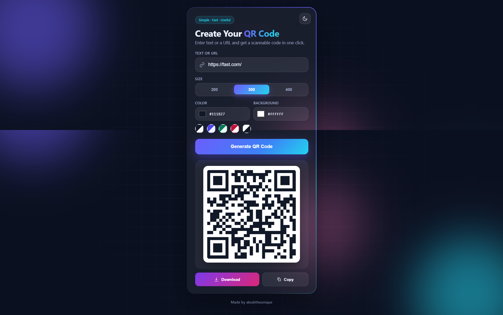

# QR Code Generator

Generate custom QR codes from text or URLs. Pick a size and colors, preview the code instantly, then download it as a PNG or copy it to the clipboard. No sign-up, no backend, no API key.

**Live demo:** https://qr-generator-gamma-lac.vercel.app

## Features

- Text or URL input with validation
- Size options (200, 300, 400 px) and custom foreground/background colors
- Color presets and a contrast warning when a code may not scan
- Download as PNG with a quiet-zone margin, or copy the image to the clipboard
- Dark mode by default with a light theme toggle that remembers your choice
- Animated glass UI: moving gradient background, glowing card border, pop-in QR reveal, toast messages
- Responsive, and respects reduced-motion settings

## Tech Stack

HTML, CSS and vanilla JavaScript, with [qrcodejs](https://github.com/davidshimjs/qrcodejs) loaded from a CDN. Hosted on Vercel as a static site.

## Run locally

~~~bash
git clone https://github.com/abukitheunique/qr-generator.git
cd qr-generator
npx serve .
~~~

Open http://localhost:3000.

## Author

Built by [abukitheunique](https://github.com/abukitheunique).
